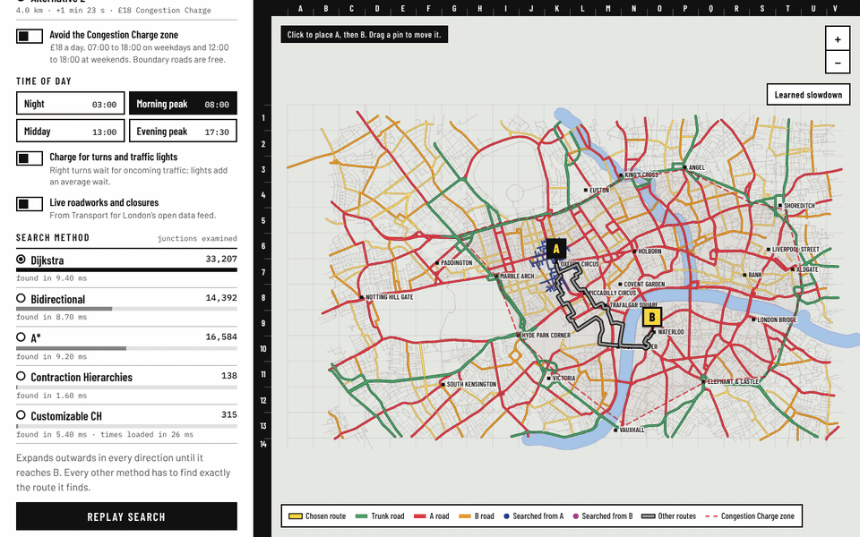

# Ridegraph

[](https://github.com/ayqon/ridegraph/actions/workflows/ci.yml)
[](https://github.com/ayqon/ridegraph/actions/workflows/ci.yml)
[](LICENSE)

Routing, arrival-time prediction and ride dispatch on real city road networks
(central London, Nicosia and Manhattan), written from scratch in Python and
JavaScript.

Live map: **https://ridegraph.dev**



## What it does

- Finds the quickest route between two points with Dijkstra, bidirectional
  search, A\* and Contraction Hierarchies, and shows how much of the city
  each one has to search.
- Takes time-of-day traffic, turn costs and traffic lights into account.
- Folds in live road closures from Transport for London in about 20 ms using
  Customizable Contraction Hierarchies.
- Offers alternative routes, and routes that avoid the London Congestion
  Charge zone.
- Draws travel-time maps (everywhere reachable in 10, 20 and 30 minutes) and
  plans the best order for a round of deliveries.
- Predicts arrival times with a model that learns how far off the router
  usually is, with a calibrated arrival window.
- Simulates ride-hailing dispatch: matching drivers to riders, moving idle
  drivers towards forecast demand, shared rides and surge pricing.
- Serves routes over an HTTP API (FastAPI, Docker image included).

Everything runs on OpenStreetMap data. The map runs entirely in the browser,
with no server.

## Results

Search work on 200 random central London trips (72,636 junctions), every
answer checked against Dijkstra:

| Algorithm | Junctions searched | Query time |
|---|---:|---:|
| Dijkstra | 37,822 | 44.9 ms |
| Bidirectional Dijkstra | 24,840 | 39.4 ms |
| A\* | 23,705 | 40.6 ms |
| Contraction Hierarchies | 97 | 1.2 ms |

Against OSRM, an independent open-source routing engine, on 1,000 random
trips with the same road speeds: travel times agree within 1% on 84% of
trips, and the routes share a median 99.7% of their junctions.

Arrival-time error on 4,000 trips the models never saw:

| Model | Mean error | Within 10% |
|---|---:|---:|
| Router alone | 27.5% | 2% |
| Router times one overall factor | 10.1% | 58% |
| Gradient-boosted trees (used on the map) | 6.8% | 78% |
| Graph neural network | 6.6% | 80% |

The arrival-time and dispatch results use simulated trips, because real trip
data for London is not public. The simulated city's speeds are checked
against Department for Transport and TomTom figures; see
[How it works](docs/how-it-works.md) for details.

## Quick start

Requires Python 3.10 or newer.

```bash
pip install -e ".[dev]"

python -m ridegraph fetch        # download central London from OpenStreetMap
python -m ridegraph build        # turn it into a routing graph
python -m ridegraph contract     # preprocess for Contraction Hierarchies

# Oxford Circus to Waterloo
python -m ridegraph route 51.5154,-0.1410 51.5033,-0.1196

# Compare the search methods
python -m ridegraph bench
```

Other cities: add `--city nicosia` or `--city new-york` to `fetch`, `build`
and `export-web`. All commands are listed in the
[command-line reference](docs/cli.md).

More examples:

```bash
python -m ridegraph route 51.5265,-0.1820 51.5100,-0.0700 --at 08:00 --alternatives --avoid-charge
python -m ridegraph reach 51.5174,-0.1200 --at 08:00
python -m ridegraph tour 51.5174,-0.1200 51.5308,-0.1238 51.5033,-0.1145 51.5154,-0.1410
python -m ridegraph eta-train --trips 20000 --out data/eta-model.json
python -m ridegraph dispatch --drivers 115 --days 6
python -m ridegraph serve        # HTTP API on port 8000
```

## Running the map locally

```bash
python -m ridegraph export-web             # writes web/data/london
python -m http.server -d web 8000          # then open http://localhost:8000
```

## Project layout

```
ridegraph/      Python package: graph, searches, traffic, learning, dispatch, API
web/            The browser map (plain JavaScript, no build step)
tests/          pytest suite, including property-based tests
docs/           Documentation site (MkDocs)
scripts/        Load test and documentation helpers
```

## Tests

```bash
pytest
```

Every search method is checked against Dijkstra on random road networks,
including property-based tests with Hypothesis. Node tests check that the
browser code gives the same answers as the Python code. CI runs linting,
type checking and the full suite on Python 3.10, 3.12 and 3.13.

## Documentation

- [How it works](docs/how-it-works.md): each part explained, with the numbers
- [Architecture](docs/architecture.md) and [design decisions](docs/decisions.md)
- [Write-up](docs/writeup.md): what the results show
- [HTTP API](docs/http-api.md)

## Data

Road data © [OpenStreetMap contributors](https://www.openstreetmap.org/copyright),
available under the Open Database License. Live road disruptions powered by
TfL Open Data; contains OS data © Crown copyright and database rights 2016
and Geomni UK Map data © and database rights 2019.

## License

MIT. See [LICENSE](LICENSE).
