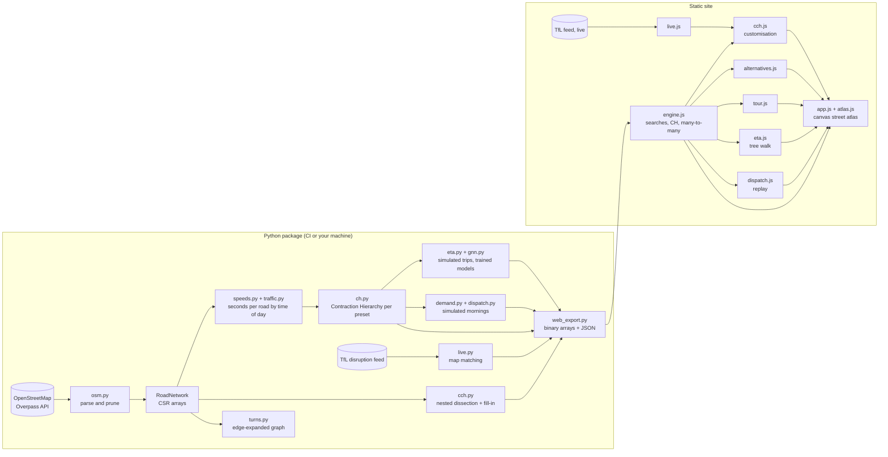

# Architecture

ridegraph is a Python package that does the heavy lifting offline and a
static web page that runs the same algorithms in the browser. There is no
server: CI builds everything and publishes files.

## Layers

**Data.** `overpass.py` downloads drivable roads with retries and mirror
fallback. `osm.py` keeps the ways a car may use, splits them into one
segment per pair of consecutive OSM nodes, respects one-way rules, and keeps
the largest strongly connected component so every route can return.

**Graph.** `graph.py` stores the network as flat arrays and builds a
compressed sparse row (CSR) graph whose edge weights are seconds.
`speeds.py` turns road class and speed limits into free-flow speeds, and
`traffic.py` scales them by time of day and by how sensitive each class of
road is to congestion. `turns.py` builds the edge-expanded graph used for
turn and traffic-light costs.

**Search.** `dijkstra.py` is the reference. `bidirectional.py`, `astar.py`,
`ch.py` (Contraction Hierarchies, with many-to-many) and `cch.py`
(Customizable CH) must all match it, and `router.py` hides which graph a
scenario needs. `alternatives.py`, `reach.py` and `tour.py` build everyday
tools on top.

**Learning.** `eta.py` simulates trips in a hidden world calibrated to
London, extracts route features and trains ridge, MLP, gradient-boosted
trees and quantile models with conformal calibration. `gnn.py` trains the
graph neural network over every road. `demand.py` forecasts ride requests.

**Decisions.** `matching.py` holds the Hungarian algorithm. `dispatch.py`
simulates a fleet under six policies on identical requests.

**Integration.** `live.py` matches TfL disruptions onto the graph,
`charges.py` holds the Congestion Charge zone, `osrm.py` prepares the
head-to-head with OSRM, and `web_export.py` writes everything the browser
needs.

## The browser

The export is a manifest plus gzipped, 8-byte-aligned binary arrays that the
browser views directly as typed arrays, so loading London takes no parsing.
`engine.js` ports every search; `cch.js` re-customises when live closures
arrive; `eta.js` walks the exported trees; `dispatch.js` replays the
simulation, rebuilding each leg's route with the same hierarchy. Node tests
run these modules against Python on the same data and require identical
answers.

## Build and deploy

| Workflow | What it does |
|---|---|
| `ci.yml` | Lint, format, mypy, the full test suite with coverage on Python 3.10, 3.12 and 3.13 |
| `pages.yml` | Fetch London, snapshot TfL, build, contract, train, simulate, export, build these docs, publish |
| `osrm.yml` | Run OSRM in Docker on the same roads and speeds and compare 1,000 random trips |
