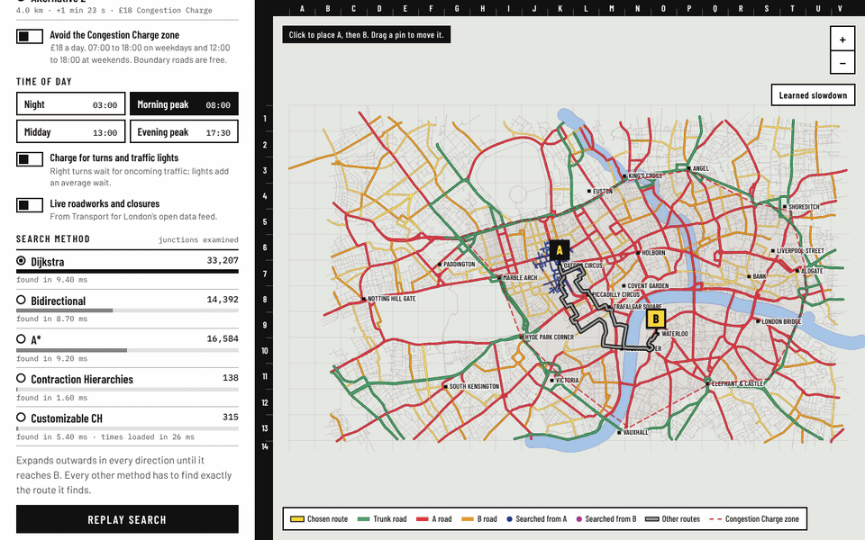

# ridegraph

Quickest routes, live closures, travel-time maps, delivery rounds, learned
arrival times and ride dispatch on central London's road network, with every
algorithm written from first principles and checked against a reference.

[Open the live map](https://ridegraph.dev/){ .md-button .md-button--primary }
[Read the code](https://github.com/ayqon/ridegraph){ .md-button }

## At a glance

| | |
|---|---|
| **Map** | 72,637 junctions and 127,286 road segments of central London from OpenStreetMap |
| **Searches** | Dijkstra, bidirectional, A\*, Contraction Hierarchies, Customizable CH |
| **Speed** | Contraction Hierarchies settle 97 junctions per query against Dijkstra's 37,822 |
| **Checked against OSRM** | Travel times within 1% on 84% of 1,000 random trips, median difference 0.23% |
| **Live traffic** | TfL closures folded in by re-customising the hierarchy in about 20 ms in the browser |
| **Learned ETA** | Error on held-out trips cut from 27.5% (router alone) to 6.8% (trees) and 6.6% (graph neural network) |
| **Dispatch** | Hungarian matching, ML demand forecast, shared rides and surge pricing compared on the same requests |
| **Quality** | 92% line coverage, property-based tests, mypy, Node tests holding the browser to Python |

## Where to go next

* [Architecture](architecture.md): how data flows from OpenStreetMap to the
  browser, and what each module owns.
* [Design decisions](decisions.md): the choices that shaped the project and
  what they cost.
* [Results](writeup.md): what the numbers say, in plain language.
* [Command line](cli.md) and [Python API](api.md): the reference.
